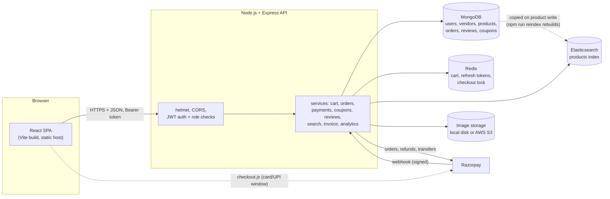
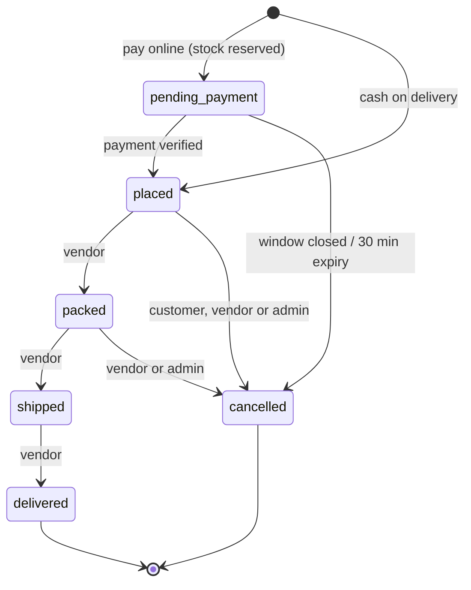
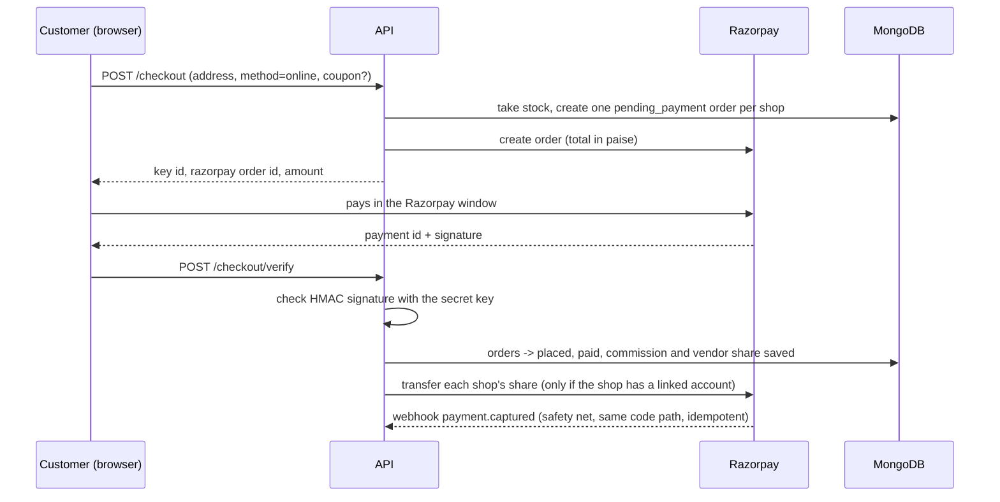

# Architecture

Stack: React (frontend), Node.js + Express (API), MongoDB, Redis, Elasticsearch, AWS S3 (optional), Razorpay (test mode).
The frontend and the backend are separate apps that talk over HTTPS and JSON. They are built, configured and deployed on their own.

## Roles

| Role | Can do |
|------|--------|
| customer | Browse and search, cart, checkout (online or cash on delivery), apply a coupon, track and cancel orders, download invoices, review delivered products |
| vendor | Onboard a shop (needs admin approval), manage own products and images, fulfil own orders (packed, shipped, delivered), create coupons for the shop, download invoices |
| admin | Approve or reject vendors, remove reviews, sales analytics, see what is owed to vendors and which refunds failed. Admins are created by the seed script only, never by sign-up |

## System diagram

## Order lifecycle

A checkout with items from several shops creates one order per shop (they share a `groupId`). Each shop packs, ships and is paid for its own order.

Cancelling puts the stock back, gives the coupon back, and refunds an online payment.

## Online payment flow (Razorpay test mode)

Rules that keep money correct:

- The browser is never trusted. An order becomes paid only after the HMAC signature matches (`/checkout/verify`) or a webhook with a valid signature arrives. Both call the same function, and each order is claimed with a conditional update, so paying twice changes nothing.
- Stock is taken before the payment window opens. If the window is closed, the stock is returned and the cart is kept. A sweep every 5 minutes cancels checkouts that stayed unpaid for 30 minutes.
- If money arrives for an order that was already cancelled or expired, it is refunded automatically. If the refund fails, the order is flagged `refund_due` and shows on the admin dashboard.
- Commission = order total (after discount) x commission percent. The percent is the vendor's own `commissionPercent`, or `COMMISSION_PERCENT` (10) when the vendor has none. For cash on delivery it is recorded when the order is delivered.
- Vendor transfers use Razorpay Route and need the vendor's `razorpayAccountId`. Without it the share is only recorded (`transferStatus: skipped`) and shows as "owed to vendors". A failed transfer never fails the customer's payment; the error is stored on the order.

## Coupons

A coupon belongs to one vendor and discounts only that vendor's items in the cart, so the vendor pays for their own discount. The code is checked again at checkout (expiry, minimum order, usage limit, once per customer) and the use is counted with an atomic update, so the last use cannot be taken twice.

## Caching and Redis

| Key | Purpose | Lifetime |
|-----|---------|----------|
| `cart:{userId}` (hash productId -> qty) | The cart. Prices are always read fresh from MongoDB, never stored in the cart | 7 days, renewed on change |
| `refresh:{userId}:{jti}` | Refresh tokens. Deleting the key logs that session out and makes each refresh token single-use (rotation) | refresh token lifetime |
| `lock:checkout:{userId}` | Stops a double click from placing the same cart twice | 30 seconds |

## Search

Elasticsearch index `products` (fields: name, description, category, vendor name, price, stock, rating, createdAt, isActive). Text search is fuzzy across name, description and category. Filters: category, price range, minimum rating. Sorts: best match, newest, price, top rated. The category list on the left is a count aggregation, and it ignores the category filter itself so the user can switch categories.

MongoDB is the source of truth. Every product write updates the index, but a failed index update never fails the write (it is logged). `npm run reindex` rebuilds the whole index from MongoDB. If Elasticsearch is down the rest of the site still works; only `/api/search` answers 503.

## Authentication

Access token (JWT, 15 minutes) plus a refresh token (JWT, 7 days, rotated on every use and tracked in Redis). Roles are checked in middleware on every protected route. Passwords are hashed with bcrypt (12 rounds).

## Deployment

The two apps are deployed independently. See [DEPLOYMENT.md](DEPLOYMENT.md).

- Frontend: any static host. `VITE_API_URL` is set at build time to the API address.
- Backend: any Node 20+ host. `CLIENT_ORIGIN` is set to the frontend address(es) for CORS.
- Data: MongoDB Atlas, a hosted Redis, and Elastic Cloud. Images go to S3 when `STORAGE=s3`.
