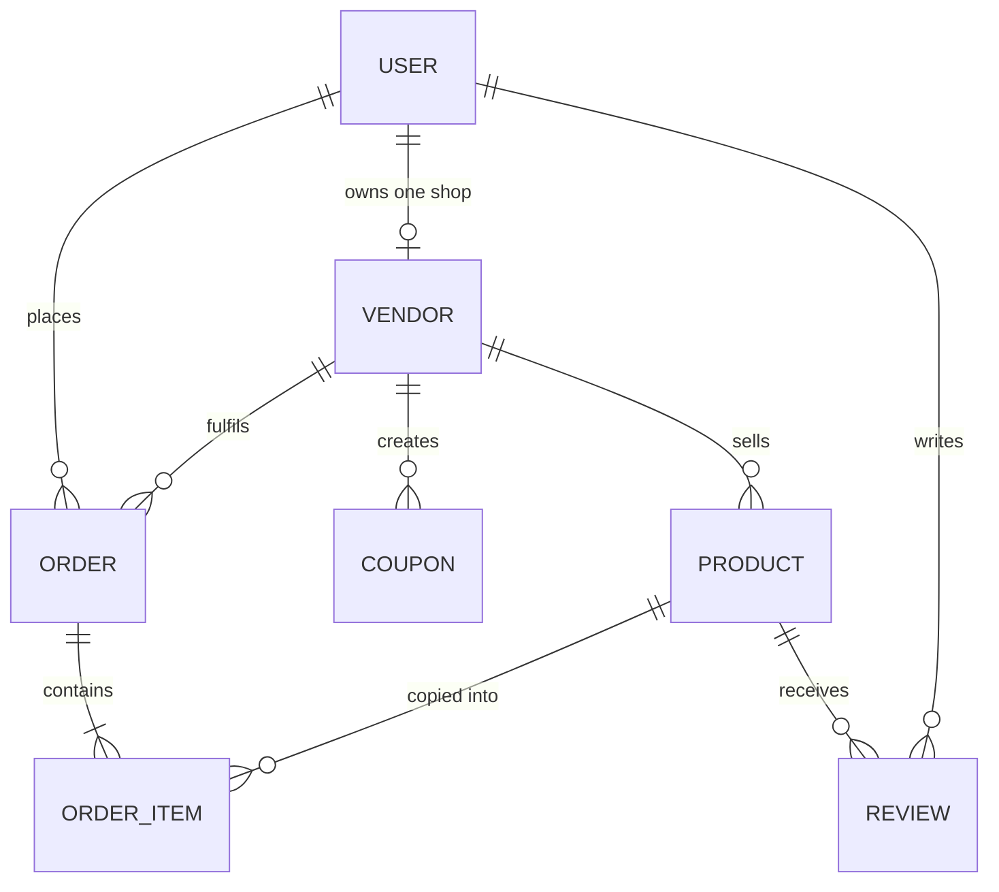

# Database schema (MongoDB / Mongoose)

Money is stored in rupees as numbers and rounded to 2 decimals. Order items keep a copy of the product name, image and price at the time of purchase, so old orders stay correct when a product is edited or deleted. All collections have `createdAt` and `updatedAt`.

## users
| Field | Type | Notes |
|-------|------|-------|
| name | String | required |
| email | String | required, unique, lowercase |
| passwordHash | String | bcrypt |
| role | `customer` / `vendor` / `admin` | default customer. Admins come from the seed only |

## vendors
| Field | Type | Notes |
|-------|------|-------|
| user | ObjectId(User) | required, unique: one shop per user |
| shopName | String | required |
| description | String | |
| status | `pending` / `approved` / `rejected` | an admin approves. Only approved vendors can sell |
| razorpayAccountId | String | Razorpay Route linked account. Empty means "ledger only" |
| commissionPercent | Number or null | null means use `COMMISSION_PERCENT` |

## products
| Field | Type | Notes |
|-------|------|-------|
| vendor | ObjectId(Vendor) | indexed |
| name, description | String | also indexed in Elasticsearch |
| category | String | indexed |
| price | Number | rupees, min 0 |
| stock | Number | min 0. Taken with a conditional update so it cannot go below 0 |
| images | [String] | URLs (local `/uploads/...` or S3) |
| ratingAvg, ratingCount | Number | recalculated from reviews |
| isActive | Boolean | hidden products are not sold or searched |

## orders (one per vendor per checkout)
| Field | Type | Notes |
|-------|------|-------|
| orderNumber | String | unique, e.g. `ORD-...` |
| groupId | String | the same for all orders of one checkout |
| customer, vendor | ObjectId | indexed |
| items | [{product, name, image, price, qty}] | snapshot |
| subtotal, discount, total | Number | total = subtotal - discount |
| coupon | {code, discount} | the coupon used, if any |
| status | `pending_payment` / `placed` / `packed` / `shipped` / `delivered` / `cancelled` | indexed |
| statusHistory | [{status, at}] | every change |
| payment.method | `cod` / `online` | |
| payment.status | `pending` / `paid` / `failed` / `refunded` / `refund_due` | `refund_due`: money taken, order cannot go ahead, automatic refund failed |
| payment.razorpayOrderId, razorpayPaymentId | String | order id is indexed |
| payment.paidAt | Date | |
| payment.commission, vendorAmount | Number | platform's cut and the vendor's share (total - commission) |
| payment.transferStatus | `none` / `skipped` / `processed` / `failed` | vendor payout state. `skipped`: shop has no linked account |
| payment.transferId, transferError | String | |
| shippingAddress | {name, phone, line1, line2, city, state, pincode} | |

## reviews
| Field | Type | Notes |
|-------|------|-------|
| product | ObjectId(Product) | indexed |
| customer | ObjectId(User) | must have a delivered order with this product |
| customerName | String | shown publicly as "Asha R." |
| rating | Number 1..5 | |
| comment | String | max 1000 chars |

## coupons
| Field | Type | Notes |
|-------|------|-------|
| vendor | ObjectId(Vendor) | discount applies to this shop's items only |
| code | String | unique, uppercase, 3-20 letters or digits |
| type | `percent` / `flat` | percent is at most 90 |
| value | Number | percent or rupees |
| minOrder | Number | minimum subtotal of the shop's items |
| maxDiscount | Number or null | cap for percent coupons |
| usageLimit, usedCount | Number | usageLimit null means unlimited |
| expiresAt | Date or null | |
| isActive | Boolean | the vendor can pause a coupon |

## Indexes
`users.email` (unique), `vendors.user` (unique), `products.vendor`, `products.category`, `orders.orderNumber` (unique), `orders.groupId`, `orders.customer`, `orders.vendor`, `orders.status`, `orders.payment.razorpayOrderId`, `reviews (product, customer)` (unique: one review per customer per product), `coupons.code` (unique), `coupons.vendor`.

Redis keys and the Elasticsearch index are described in [ARCHITECTURE.md](ARCHITECTURE.md).
